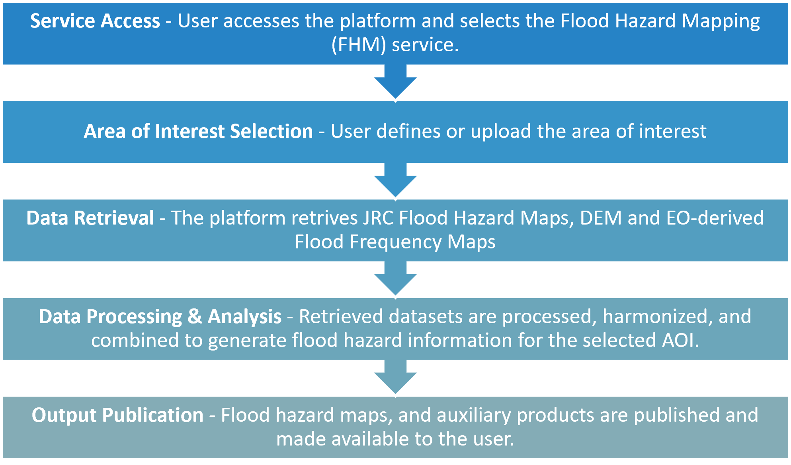
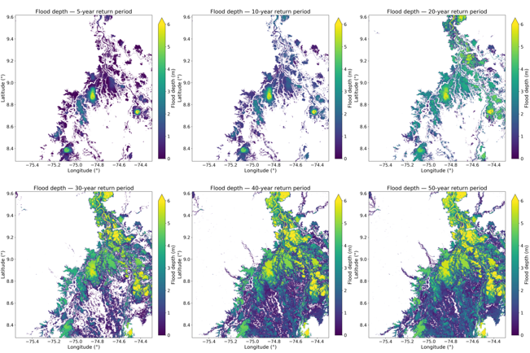
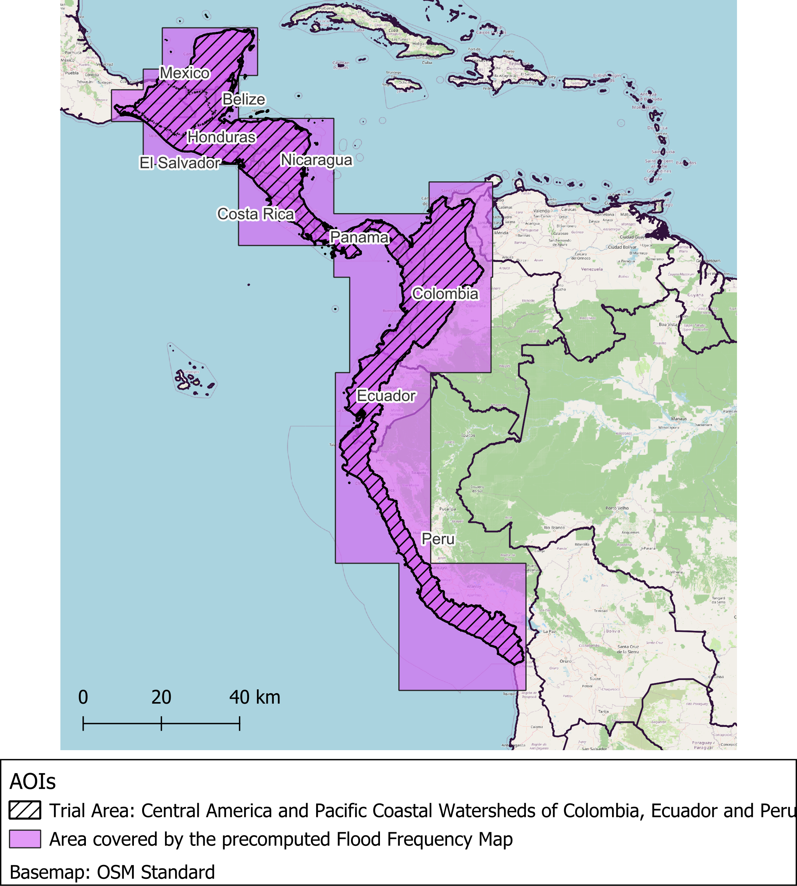
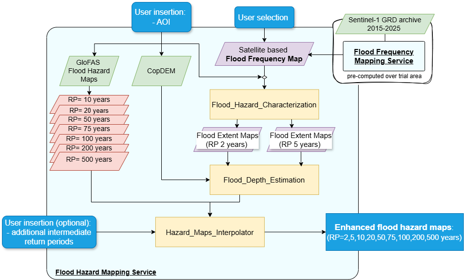

Flood Hazard Mapping Details
============================

The FHM service generates a set of enhanced flood hazard maps by merging modelled hazard maps from
the Global River Flood Hazard Maps dataset [1]_ and the empirical flood frequency map derived
from the Flood Frequency Mapping service based on Sentinel-1 data. The Global River Flood Hazard
Maps dataset was produced as part of the Global Flood Awareness System (GloFAS) of the Copernicus
Emergency Management Service (CEMS). They rely on input river flow data provided by the open-source
hydrological model LISFLOOD, while inundation simulations are performed with the hydrodynamic model
LISFLOOD-FP.

The FHM service produces a set of enhanced flood hazard maps, expressed as water depth and water
surface elevation maps, for nine different return periods: 1-in-X-years where X equals to 2, 5, 10,
20, 50, 75, 100, 200, and 500. Table 1 compares the difference between the Global River Flood Hazard
Maps dataset (henceforth referred to as GloFAS flood hazard maps, for the sake of clarity) with the
FHM service of CopernicusLAC.

.. list-table:: Comparison of GloFAS flood hazard maps and the CopernicusLAC FHM service
   :header-rows: 1
   :widths: 23 38 39

   * - 
     - GloFAS Global River Flood Hazard Maps
     - CopernicusLAC’s FHM service
   * - Return periods
     - Seven (10, 20, 50, 75, 100, 200, and 500 years)
     - Nine (2, 5, 10, 20, 50, 75, 100, 200, and 500 years)
   * - Spatial resolution
     - 90 m (3 arc seconds)
     - 30 m (1 arc second)
   * - Tiling and coverage
     - Fixed global grid (10°x10° tiles)
     - Dynamic area of interest (custom regions as needed)
   * - Data format and catalog
     - GeoTIFF (standard format)
     - GeoTIFF (standard format)
   * - DEM reference
     - SRTM 90m
     - CopernicusDEM (GLO-30)

   *Fig.1 - Sequence schematic of the FHM service.*

The service integrates empirical flood observations derived from Sentinel-1 satellite data with
model-based inundation scenarios from GloFAS (CEMS). Flood extent maps are reconstructed from
Sentinel-1 imagery through the Flood Extent Mapping service, and a flood frequency map is computed
over a historical archive through the Flood Frequency Mapping service. The Flood Hazard Mapping
service can use an existing flood frequency map available in the processing workspace, including a
user-provided map, or initiate its generation if no suitable map is available.

From this empirical frequency map, flood extent maps corresponding to low return periods (2 and 5
years) are derived, and associated water depths are estimated through the **GradientHydro algorithm**, a
physics-aware optimization framework (LIST’s patented software, reference: LU602214). These EO-based
products, specifically the 5-year flood extent map, are then combined with the GloFAS model-based
hazard maps for the higher return periods (10 to 500 years), over which water depths are recomputed
accordingly. The full set of nine return period maps, combining the empirical reliability of
satellite observations with the spatial consistency and completeness of hydrological and hydraulic
modelling, constitutes the initial set of flood hazard maps generated by the service.

Once these flood hazard maps are computed, an additional interpolation procedure is applied. The
procedure uses the RP5 and RP50 hazard maps as reference conditions to update the intermediate RP10
and RP20 maps, with the aim of improving the consistency of the transition between EO-derived flood
hazard information and GloFAS model-based inundation scenarios.

The main benefits are expected for flood hazard maps corresponding to low return periods, as shown
in Figure 2.

   *Fig.2 - Example of interpolated flood hazard maps for La Mojana, Colombia, at return periods of 5, 10, 20, 30, 40 and 50 years.*

The service also supports the generation of flood hazard maps for additional user-defined return
periods through interpolation.

The service operates on a user-defined Area of Interest (AOI) and requires a Flood Frequency Map as
input. Users can select an existing map available in the processing workspace, including a
user-provided map, or initiate the generation of a new map from historical Sentinel-1 or Sentinel-2
observations through the Flood Frequency Mapping service.

To facilitate the use of the service and avoid the time-consuming processing of historical satellite
observations, a **precomputed Flood Frequency Map** has been made available. This map was derived from
Sentinel-1 observations acquired between 2015 and 2025 and covers a trial area of approximately 1.5
million km², encompassing Central America and the Pacific coastal watersheds of Colombia, Ecuador,
and Peru as shown in the figure below:

   *Fig.3 - Geographical coverage of the precomputed Sentinel-1 Flood Frequency Map.*

The map is available in a dedicated shared workspace of the CopernicusLAC Specialized Processing
Environment (PE). Whenever the user-defined AOI falls entirely within the geographical coverage of
the precomputed Flood Frequency Map, using this existing map is recommended to avoid unnecessary
reprocessing of the satellite archive.

For AOIs outside this coverage, the service can generate a new Flood Frequency Map from historical
satellite observations. However, this process may require substantial processing time, depending on
the AOI size, the selected observation period, and satellite data availability.

Workflow
--------

The figure below illustrates the high-level workflow of the FHM service, focusing on the configuration in which an existing
Flood Frequency Map is selected by the user. This represents the recommended option when a suitable map is already available, such as the precomputed map covering the trial area shown in Figure 3.

Alternatively, if no suitable Flood Frequency Map is available for the selected AOI, the FHM service can automatically initiate the generation of a new map through the integrated Flood Frequency Mapping processing chain, using historical Sentinel-1 or Sentinel-2 observations, according to the parameters specified by the user. Once generated, the new Flood Frequency Map is used as input to the same flood hazard characterization and depth estimation workflow shown in Figure 4.

   *Fig.4 - Workflow of the FHM service illustrating the use of an existing Flood Frequency Map as input. When no suitable map is available, a new Flood Frequency Map can be generated directly through the service before the subsequent processing steps*

Below are given details of each step of the chain described in the FHM workflow.

User Insertion
^^^^^^^^^^^^^^

The user defines the AOI and selects the Flood Frequency Map to be used as input. An existing map
can be selected from the processing workspace, including the precomputed map (Fig.3), or a user-provided map can be made available in the workspace. Alternatively, if no suitable
map is available, the service can initiate the generation of a new Flood Frequency Map from
historical Sentinel-1 or Sentinel-2 observations.

Hazard Characterization
^^^^^^^^^^^^^^^^^^^^^^^

Flood extent maps for 2-year and 5-year return periods (RP2, RP5) are produced through systematic
probabilistic classification of the (cropped and mosaicked) Flood Frequency raster. The Flood
Frequency map was constructed from 10 years of historical flood observations, providing an empirical
basis for probability estimation. By thresholding the frequency map at 50% and 20% annual exceedance
probability, respectively, we delineate spatial zones representing frequent flood hazards—RP2 areas
inundated in approximately 1 in 2 years, and RP5 areas flooded in approximately 1 in 5 years.

Flood Depth Estimation
^^^^^^^^^^^^^^^^^^^^^^

Flood Depths Estimation (Estimation of Flood Depths for Low Return Period Floods (RP2 and RP5)):

The depth estimation for RP2 and RP5 extents is carried out using GradientHydro. This software is
integrated with the Specialized PE. Its methodology can be summarized as follows:

Input preparation: The observed flood extent, a DEM, and optional water-body and building layers are
aligned to the same grid and coordinate system. Flood cells are converted to a binary
flooded/not-flooded representation, and no-data areas are excluded.

Over-detection screening: Each flood object is scored for how plausible it is as real inundation.
The score considers whether the object connects to a nearby water body, whether it sits in a
topographic depression relative to its surroundings, and whether its size is consistent with the
expected minimum area (default to 1 ha). Objects that are weakly connected, sit on higher ground
than their surroundings, or are very small receive higher suppression weights. Cells near the
observed flood boundary that are not yet classified as flooded are flagged as unconstrained.

Water surface estimation: The WSE is estimated iteratively, starting from the terrain and
progressing from coarse to fine resolution. At each resolution, the estimate is adjusted to fit the
observed flood extent (so-called data fidelity), physical constraints (smoothness and curvature of
the water surface), the suppression weights, and the expected water level in channels (if a channel
mask is provided). When the estimate stabilizes at a resolution, it is refined at the next finer
one.

Depth and extent recovery: Water depth is calculated as the estimated WSE minus the terrain
elevation. Depths below a very small threshold (0.1 cm) are set to dry, and water outside the
observed extent (with a small buffer equal to 2 pixels) is removed. The final flood extent is the
set of cells where the water surface is above the terrain.

Interpolator
^^^^^^^^^^^^

To enable a realistic transition between satellite-based (for RP of 2 and 5 years) and model-based
flood hazard maps (RP ≥ 10 years) the FLOODfill tool was used, which fills the gaps between
user-provided flood hazard maps, through physically informed interpolation. The tool provides a
flexible, physically informed spatial interpolation approach for generating flood hazard maps at
user-defined return periods from a limited set of available hazard maps. It is based on Piecewise
Cubic Hermite Interpolating Polynomial interpolation (PCHIP) [2]_, combined with a virtual-lake
approach, to derive intermediate hazard scenarios while maintaining a consistent relationship
between flood volumes, return periods, and the spatial distribution of inundation.

The procedure is based on the consideration that model-based flood maps tend to overestimate the
inundated area, particularly for low return periods, due to simplifications in the elevation model
as compared to reality and to the absence of information on local flood protections. To mitigate
such bias, the FLOODfill tool is run using as input the satellite-based maps (RP of 2 and 5 years)
and the set of model-based maps for return periods equal and larger than 50 years, which for the
study area of CopernicusLAC include the maps with return period above the typical return periods of
local flood protections.

The procedure first establishes a common spatial domain and ensures that flood depths are
non-negative and consistently ordered with increasing return periods. PCHIP is then used to
interpolate the relationship between return period and the aggregate flood depths across the study
area, providing a smooth, shape-preserving representation of the hazard response. This relationship
is used within a virtual-lake formulation, which represents the spatial distribution of flood depths
through equivalent water levels and associated level-volume curves, allowing intermediate hazard
maps to be derived from the original simulations.

The tool allows users to freely define both the number of output maps and their associated return
periods, providing full control over the resolution of the resulting hazard dataset. For this
application, FLOODfill enables to improve the representation of flood hazard maps between 5 and 50
years, not only by improving flood maps at RP of 10 and 20 years but also enabling the generation of
maps with return periods of interest, yet not covered by the input dataset (e.g., RP of 30 and 40
years), as well as maps with finer spacing for larger flood magnitudes, without requiring new
hydraulic simulations.

Stage-out
^^^^^^^^^

End points of the service to store the results.

Input
-----

The following inputs are needed to run the service:

- Flood Frequency Map: Derived from Sentinel-1 imagery (via the Flood Frequency Mapping Service):
  Sentinel-1 GRD pairs of tiles overlapping the AOI subsequently acquired in the same orbit
  geometry, from which are derived through the Flood Frequency Mapping Service the following
  intermediate products: Flood Count Map and Data Count Map. This input layer can be obtained
  through one of the following options:

  - Existing Flood Frequency Map: A previously generated map available in the processing workspace,
    including the precomputed Sentinel-1 Flood Frequency Map (2015–2025) covering the area
    shown in Fig.3, or a user-provided map.

  - New Flood Frequency Map: A map generated on demand from historical Sentinel-1 or Sentinel-2
    observations through the CopernicusLAC Flood Frequency Mapping service.

- JRC’s Global River Flood Hazard Maps (Global 3-arcsecond resolution flood inundation depth maps
  along river network, at seven different return periods)
  https://data.jrc.ec.europa.eu/dataset/jrc-floods-floodmapgl_rp50y-tif

- Copernicus GLO-30 Digital Elevation Model (Global DEM at a 30-meter resolution) [3]_

Parameters
----------

The following parameters are needed to run the service:

- ``Area of Interest``: the Bounding Box that defines the specific Area of Interest (AOI) for the
  analysis.

- ``Frequency Map``: A GeoTIFF raster representing empirical flood frequency, with each pixel showing
  how many times it was flooded out of the total number of times it was observed, with values
  ranging from 0 to 1 or from 0 to 100. An existing map can be selected from the processing
  workspace, including a user-provided map. Alternatively, the service can generate a new Flood
  Frequency Map from historical satellite observations if no suitable map is available. The selected
  map must cover the entire user-defined AOI.

- ``ADDITIONAL_RPS``: an array of integer values indicating the additional RPs for which to compute
  hazard depth maps through interpolation. Its default value is None, meaning that no additional
  maps will be computed through interpolation.

The following additional parameters are used only when a new Flood Frequency Map needs to be
generated from historical satellite observations:

- ``ARCHIVE_START_DATE``: The start date of the archive to compute a flood frequency map. Its default
  value is 2020-01-01.

- ``ARCHIVE_END_DATE``: The end date of the archive to compute a flood frequency map. Its default value
  is 2025-12-31.

- ``MISSION_TO_COMPUTE_FFM``: The type of Sentinel data to compute flood maps. Its default value is S1.

- ``DELETE_TMP``: Option to delete or maintain intermediate files. Its default value is true.

Output
------

The service will produce the following outputs:

- Enhanced Flood Hazard maps for nine different return periods (2, 5, 10, 20, 50, 75, 100, 200, and
  500 years)

- Definition: flood hazard for each Return Period expressed as **water depth (m)** and **water surface
  elevation (m a.s.l)**

- Data type: Geospatial layers

- Format: GeoTIFF

- Spatial resolution: The horizontal resolution of the resulting product is of 30 meters.

- Frequency: obtained on demand

- Spatial coverage: The service is available for the whole LAC region.

- Temporal coverage: NA

- Constraints: availability of EO acquisitions, availability the GloFAS Hazard Maps

References
-----------------------------------------

.. [1] Baugh, C., Colonese, J., D'Angelo, C., Dottori, F., Neal, J., Prudhomme, C., and Salamon, P.: Global river flood hazard maps, 2024. European Commission, Joint Research Centre [Dataset] doi: 10.2905/JRC.VD32YWG PID: http://data.europa.eu/89h/jrc-floods-floodmapgl_rp50y-tif
.. [2] F.N. Fritsch, J. Butland, A Method for Constructing Local Monotone Piecewise Cubic Interpolants, SIAM J. Sci. and Stat. Comput. 5 (1984) 300–304. https://doi.org/10.1137/0905021.
.. [3] Copernicus DEM – Global Digital Elevation Model - COP-DEM_GLO-30 https://doi.org/10.5270/ESA-c5d3d65

