Flood Hazard Mapping Service Tutorial
=====================================

The Flood Hazard Mapping (FHM) service, as detailed in the Service Specifications, requires a Flood Frequency Map as input, to generate flood hazard maps for different return periods.

To facilitate the use of the service and avoid time-consuming processing, a precomputed Flood Frequency Map has already been generated from the Sentinel-1 archive covering the period 2015-2025. The map covers a trial area of approximately 1.5 million km², encompassing Central America and the Pacific coastal watersheds of Colombia, Ecuador and Peru, as shown in Figure 1.

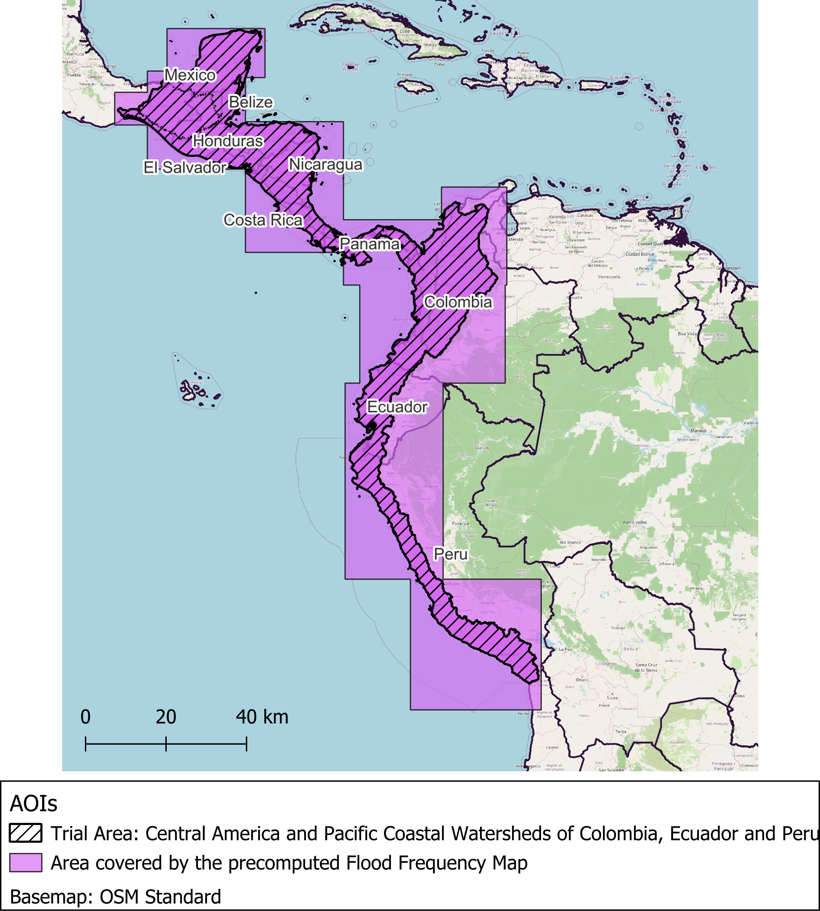

   Geographical coverage of the trial area (Central America and the watersheds of pacific coast of Colombia, Ecuador and Peru) and the final footprint of the precomputed Flood Frequency Map derived from Sentinel-1 observations (2015-2025).

The precomputed map is stored in a shared workspace on the CopernicusLAC Specialized Processing Environment (PE). A workspace is a dedicated environment where users can organize input datasets, run processing applications, and store and visualize the resulting products.

**Workspace name:** ``CopLac_Hazard_Depth``

The workspace is to be shared with registered CopernicusLAC users. Please, refer to the `Access the platform <https://coplac-hydromet-hazards.readthedocs.io/en/latest/specializedPE.html>`_ section to ensure that you are properly registered as a CopernicusLAC user and have requested access to the workspace.

You can access the workspace in two ways:

1. Direct link (once you are already logged in): `CopLac_Hazard_Depth <https://coplac.wasdi.net/#/edit/6eb3e828-2638-4fb6-8aa2-9d814ae4f29e>`_

2. From the workspaces manager: this workspace is visible in your workspaces list, as shown in Figure 1 if you are correctly registered as a CopernicusLAC user (check the Access the platform section).

  If you encounter any issues accessing the workspace, please contact business-team@wasdi.cloud and request access.

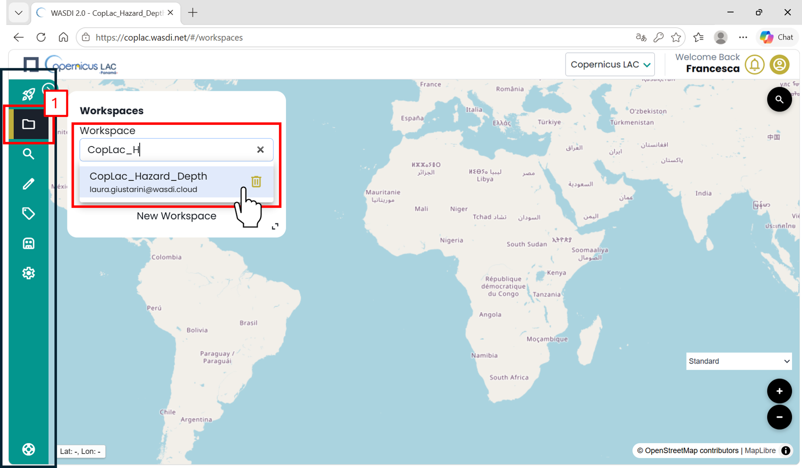

   CopernicusLAC Flood Hazard Mapping workspace: accessing the CopLac_Hazard_Depth workspace from the platform Workspace Menu.

For this tutorial, users are strongly encouraged to use the precomputed Flood Frequency Map, avoiding the need to generate a new map from the historical satellite archive. Nevertheless, the service offers also the possibility to select a time period over which to compute an archive of flood maps, either from Sentinel-1 or from Sentinel-2, derive a Flood Frequency Map from such an archive and run on this the service for hazard mapping. However, this might require a long computational time, ranging from hours to weeks, depending on the extent of the AOI and of the length of the archive.

Flood Hazard Mapping App
------------------------

Accessing the Application
^^^^^^^^^^^^^^^^^^^^^^^^^

From the marketplace of the CopernicusLAC Specialized PE, select the Flood Hazard Mapping (FHM) Service App:

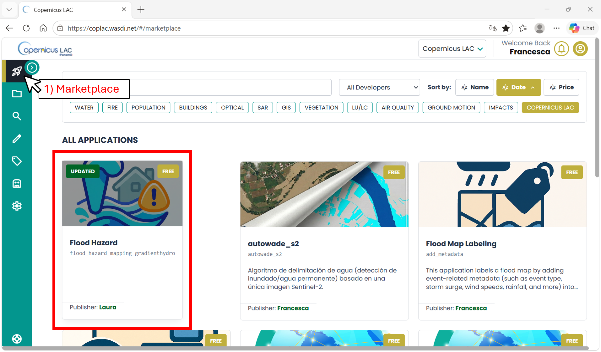

   Flood Hazard Mapping App in the CopernicusLAC Specialized PE Marketplace

Open the application:

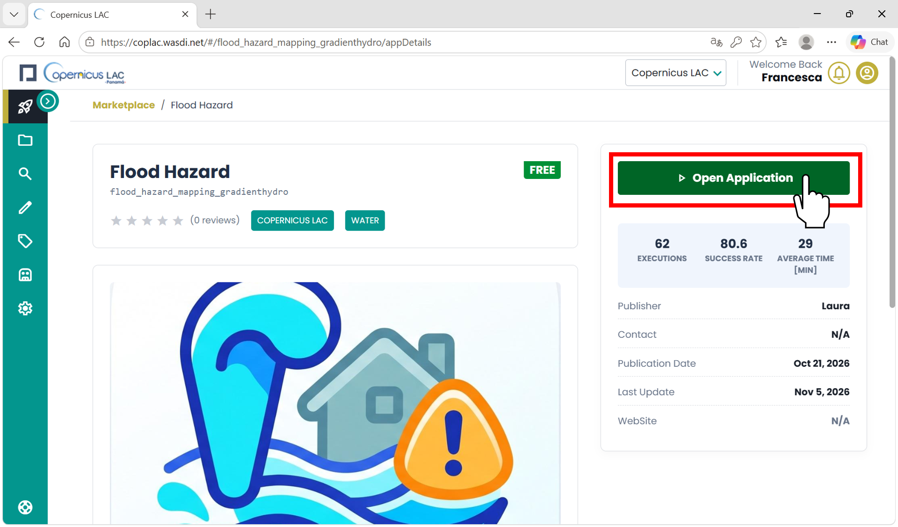

   Opening the Flood Hazard App

FHM Application Menu and Workspace selection
^^^^^^^^^^^^^^^^^^^^^^^^^^^^^^^^^^^^^^^^^^^^

The Main Menu, on the left side of the application interface, provides access to the tabs used to configure and run the service.

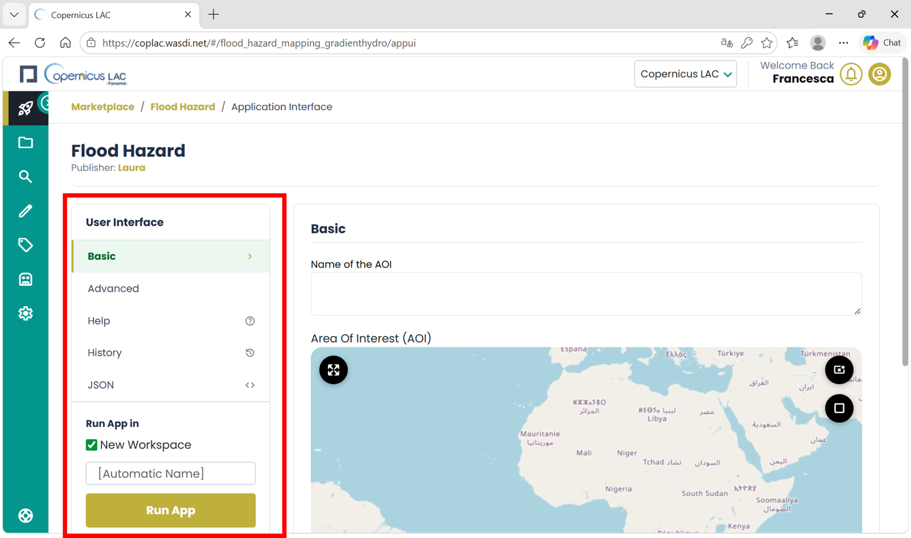

   Flood Hazard Mapping App: user interface

To get started, scroll to the bottom of the Main Menu and select the workspace in which to run the application. When using the FHM App you have to select whether to run the application in an Existing Workspace or a New Workspace:

* **Existing Workspace (recommended)**: Select this option to run the application in a workspace that already contains a Flood Frequency Map. A dropdown menu will appear, allowing you to select one of the workspaces available to your account. For this tutorial, select **CopLac_Hazard_Depth**, which contains the precomputed Flood Frequency Map described above. The resulting Flood Hazard Maps will also be stored in the selected workspace.

* New Workspace: The service also allows you to create a new workspace and launch the app on it. However, the new workspace will initially be empty, meaning that a Flood Frequency Map must be generated or otherwise made available before the Flood Hazard Mapping process can be performed. Before running the app in a new workspace, please check whether your Area of Interest is already covered by the precomputed Flood Frequency Map shown in Figure 1. If it falls outside this coverage, and you need to compute a new flood frequency map, you can select a new workspace. If you choose New Workspace, you can either assign a custom name or let the system automatically generate one for you [Automatic Name].

In this tutorial, select the CopLac_Hazard_Depth workspace.

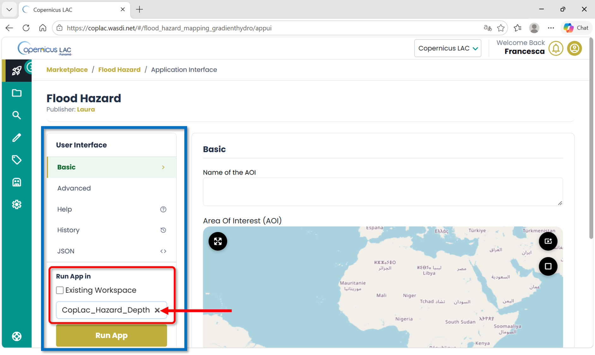

   Selecting the existing "CopLac_Hazard_Depth" workspace containing the precomputed Flood Frequency Map.

Basic Parameters
^^^^^^^^^^^^^^^^

Fill in Basic parameters:

* *Name of the AOI*: fill in the entry with a string representing the prefix to all output maps: this string is expected to not contain any "_". Its default value is "AOI".

In the example, the Name assigned is "SantaCruz":

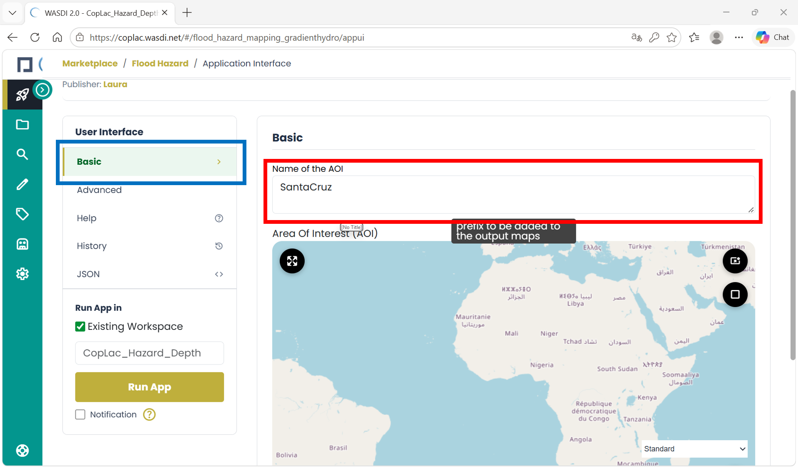

   Name of the AOI

* *Area of Interest (AOI)*: Define the geographical area to be processed.

As shown in Figure 8, you can use the rectangle tool (a) to draw the AOI on the map or use the coordinate-entry tool (b) to enter the AOI bounding-box coordinates.

.. important::

   The AOI must fall entirely within the coverage of the Flood Frequency Map selected as input.

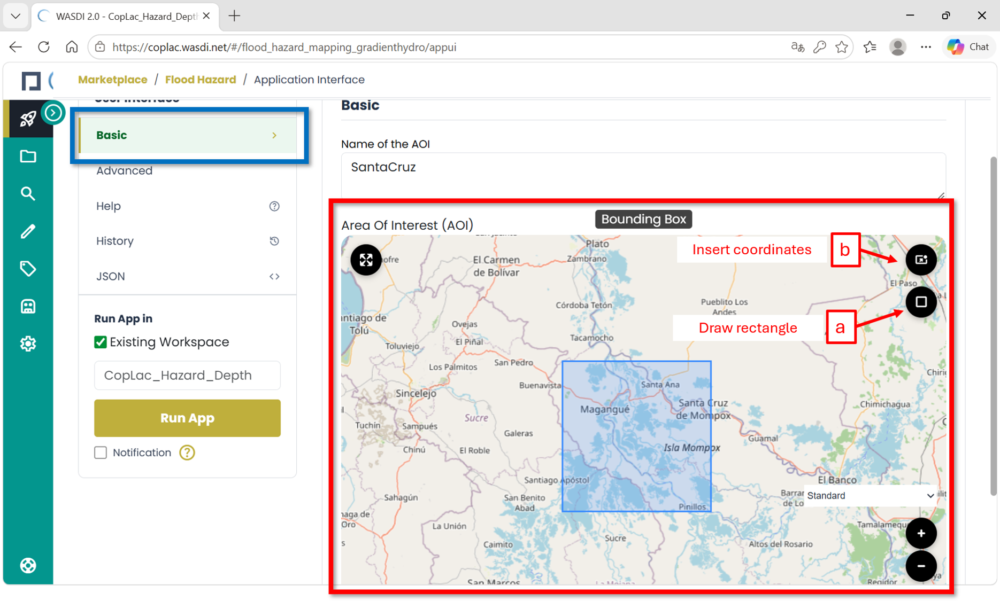

   Defining the AOI by drawing a rectangle on the map (a) or entering bounding-box coordinates (b).

* *Name of the flood frequency map*: select the flood frequency map that you want to use for your analysis from the dropdown list. Select the *CentralAmerica_Pacific_watershed_2015-2025_S1_frequency_map.tif*. This is the flood frequency map precomputed over the trial area, covering the area shown in Figure 1. This layer must be available in the workspace you selected as your working environment.

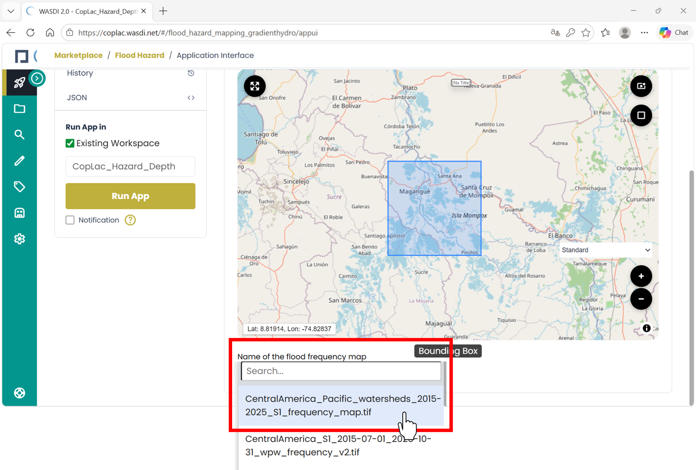

   Selecting the precomputed Flood Frequency Map derived from the Sentinel-1 archive (2015-2025).

Advanced Parameters
^^^^^^^^^^^^^^^^^^^

The Advanced tab contains options for:

* generating a new Flood Frequency Map,

* specifying additional return periods

*Generating a new Flood Frequency Map (optional)*: If the precomputed flood frequency map is not suitable for your AOI, you can specify the start and end dates and choose the Sentinel-1 or Sentinel-2 input data for frequency-map generation. The AOI defined under Basic Parameters will then also be used for this computation. Processing the historical satellite archive can take a substantial amount of time, depending on AOI size, observation period, and data availability. By default, the delete option is enabled to automatically remove intermediate layers generated during flood frequency map processing.

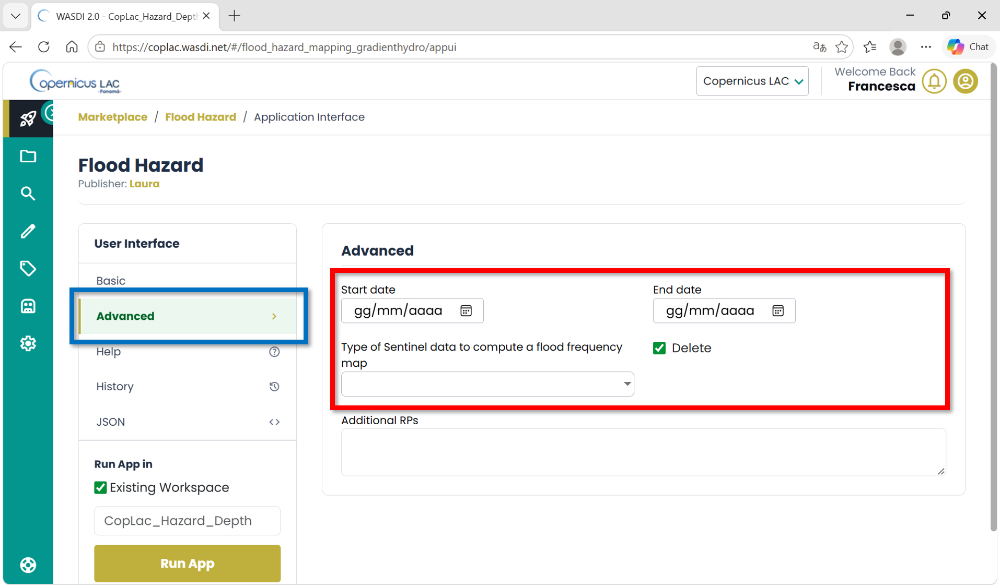

   Advanced Parameters: options for generating a new Flood Frequency Map (optional)

*Additional return periods (RPs)*: By default, the service generates hazard maps for nine return periods: 2, 5, 10, 20, 50, 75, 100, 200, and 500 years. The Additional RPs field allows users to request further periods through the service interpolator (e.g., 135 years). Leave this field empty to generate only the standard return periods.

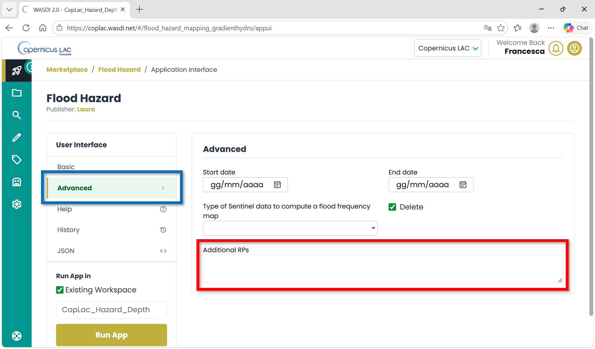

   Advanced parameters: additional return periods

Running the Application
^^^^^^^^^^^^^^^^^^^^^^^

Once all parameters are set, click the "Run App" button in the Main Menu. The platform will automatically redirect you to the workspace you selected—either an existing one or the newly created workspace.

In the workspace where the app is running, you can check at any time the status of its execution by clicking on the arrow at the bottom-right corner.

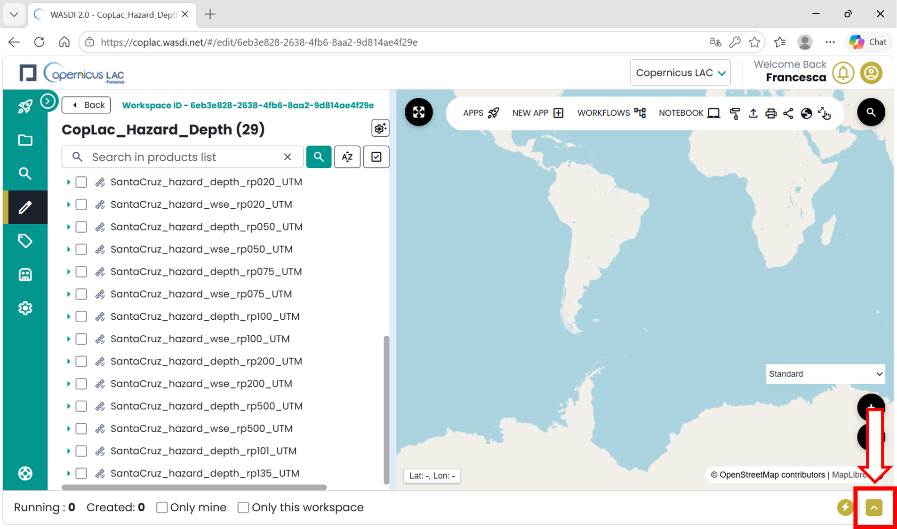

   CopernicusLAC Specialized PE workspace view: check status of the apps

"Created", "Running", "Ready" or "Waiting" states indicate that the application is still in its execution phase. “Done”, “Error” or “Stopped” states represent that the execution of the application has ended.

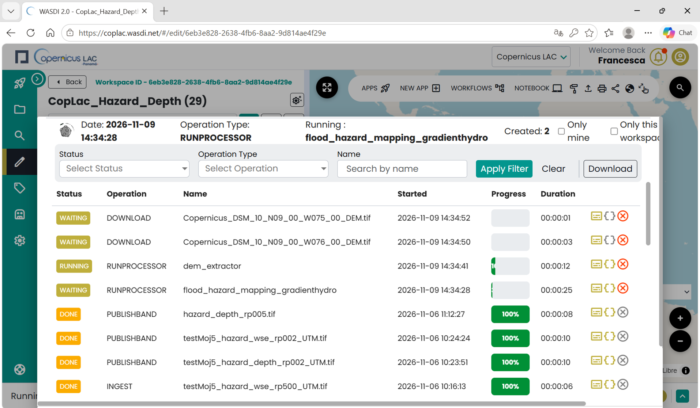

   CopernicusLAC Specialized PE workspace view: details about the execution of an app

Output, data visualization and download
---------------------------------------

The service will produce as output a list of tif files in WGS84 projected coordinates (UTM of the center point of the AOI), named:

* ``BASENAME_hazard_depth_rpXXX_UTM.tif``

* ``BASENAME_hazard_wse_rpXXX_UTM.tif``

where BASENAME is the "Name of the AOI" provided in the inputs and XXX is the RP. Maps with "depth" in their name show the depth (m) of water in each pixel for a given RP. Maps with "wse" in their name show the elevation (m a.s.l.) of water in each pixel for a given RP. The no data values of the outputs is -9999.

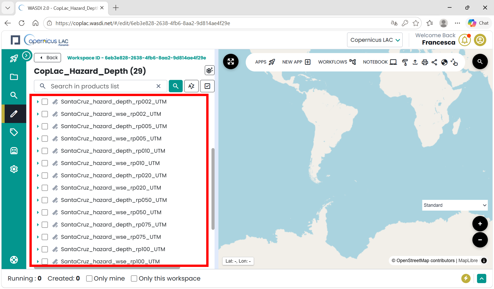

   CopernicusLAC Specialized PE: example of a workspace where the Flood Hazard Mapping service has been executed, in the left-hand panel the list of resulting output layers.

**How to display data in your workspace in the Specialized PE?**

* Find your layer of interest in your workspace, expand the selection and toggle on the layer of interest and click on the lightbulb icon.

* The selected layer will be displayed on the map, and the product should appear in the list of products in the Layer panel.

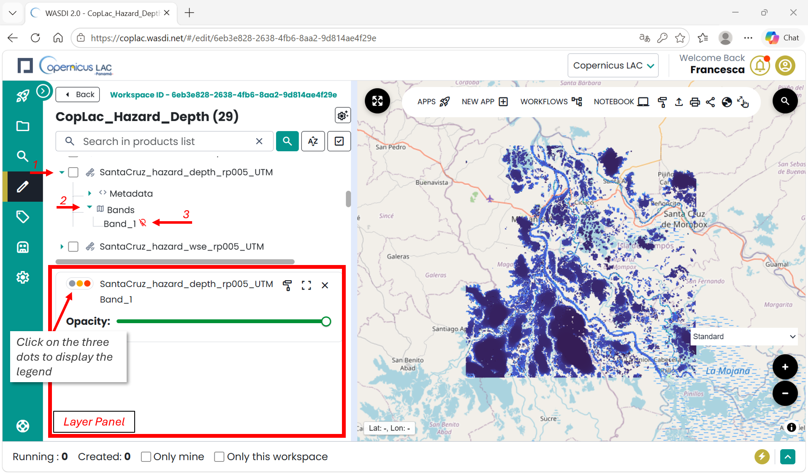

   CopernicusLAC Specialized PE map visualization

**How to download data from your workspace in the Specialized PE?**

* Access your CopernicusLAC Specialized PE workspace

* Find your layer of interest in your workspace and select it. The download option will appear on top of the layer list.

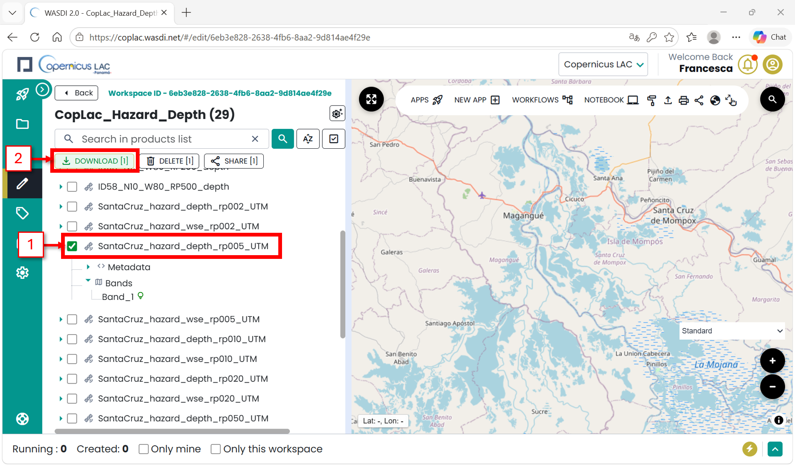

   CopernicusLAC SpecializedPE data download
